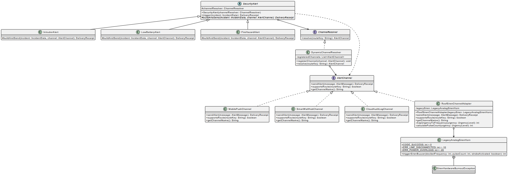

# Smart Home Security System (Bridge and Adapter patterns)

Individual assignment combining the Bridge and Adapter design patterns.

## Domain

Smart home incident routing that decouples security alert business logic from physical notification hardware, while adapting an incompatible legacy analog roof siren into the system.

## Project Structure



- `com.smarthome.abstraction` : Bridge Abstraction (`SecurityAlert`) and refined alert variants.
- `com.smarthome.implementor` : Bridge Implementor interface (`AlertChannel`) and domain exceptions.
- `com.smarthome.implementor.nativeimpl` : Native channels (Mobile Push, Wall Hub, Cloud Audit).
- `com.thirdparty.hardware` : External legacy siren driver (`LegacyAnalogSirenHorn`).
- `com.smarthome.implementor.adapter` : Adapter class (`RoofSirenChannelAdapter`).
- `com.smarthome.routing` : Dynamic implementor selection module (`DynamicChannelResolver`).
- `com.smarthome.test` : Unit test suite covering delegation, error translation, and routing.

## How to run

Prerequisites: JDK 17+ and Apache Maven.

Run the full test suite with:

```bash
mvn clean test
```
